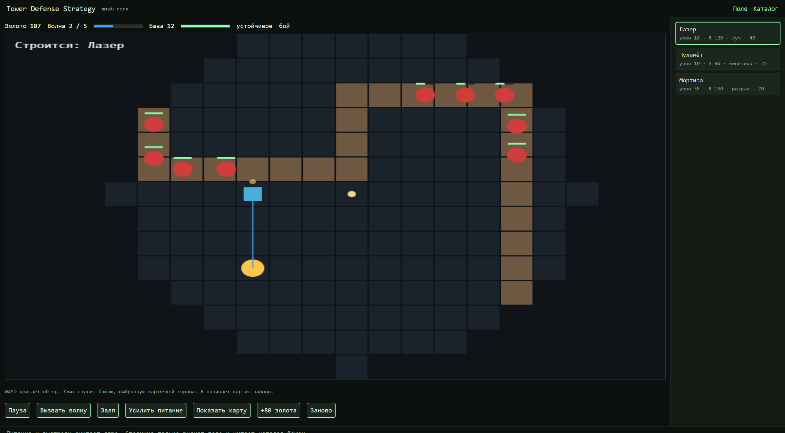

# Tower Defense Strategy

Сайт варианта 23. Посередине поле из виджета, справа магазин башен. Карточки читаются из LocalStorage, ключ `defense_towers`, тот же, что у каталога.

## Запуск

Двойной щелчок по `ЗАПУСК_САЙТ.bat` в этой папке. Окно не закрывать. Та же команда из корня проекта:

```bash
python -m http.server 8765
```

Главная: http://localhost:8765/06_сайт/

Каталог: http://localhost:8765/06_сайт/pages/inventory.html

Нужен именно http-адрес. По `file://` модули ядра, виджета и каталога не загрузятся.

## Страницы

- `index.html` — холст, показатели, кнопки сценариев, магазин.
- `pages/inventory.html` — добавление, фильтр, правка и удаление типов башен.

Каркас страницы собран CSS Grid: шапка, поле, магазин, подвал. Магазин и шапка внутри себя стоят на Flexbox. На ширине до 768 px верхние ссылки скрываются, остаётся кнопка ☰. Подсказки прячутся, холст ограничен высотой окна, у страницы поля нет вертикальной прокрутки.

## Управление полем

WASD или стрелки двигают жёлтую точку обзора. Дальше 280 px клетки не рисуются. Клик ставит башню, чья карточка выделена справа. R начинает партию заново.

Клик по карточке включает режим постройки этого типа: подпись над полем показывает название, золото списывается по цене карточки.



## Показатели

Золото, номер волны и здоровье базы берутся из объекта партии каждый кадр. Полоска базы зелёная, пока здоровья больше двух третей, жёлтая до трети и красная ниже. Синяя полоска — сколько волн уже выпущено. Узлы не пересоздаются.

## Как проверить магазин

1. Открыть главную и каталог в двух вкладках одного адреса `localhost:8765`.
2. В каталоге добавить тип, например «Тесла», урон 20, радиус 100, энергия «дуга», цена 50.
3. На главной карточка появляется сама, страницу обновлять не нужно.
4. Выбрать карточку и кликнуть по свободной клетке рядом с генератором. Башня ставится, если хватает золота.
