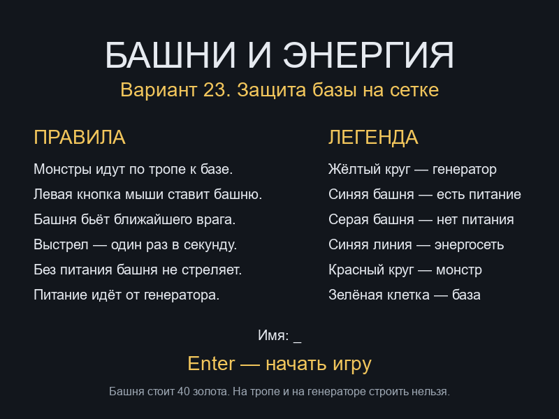
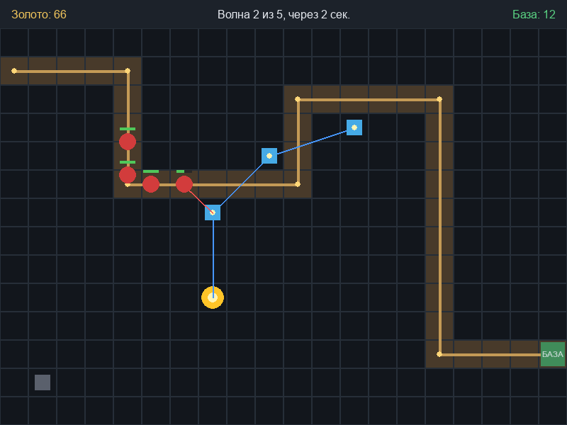
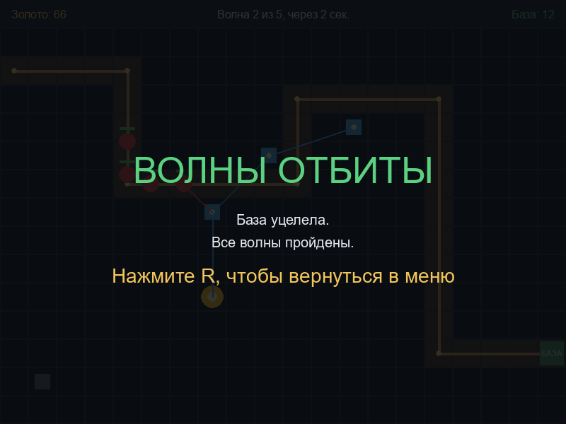
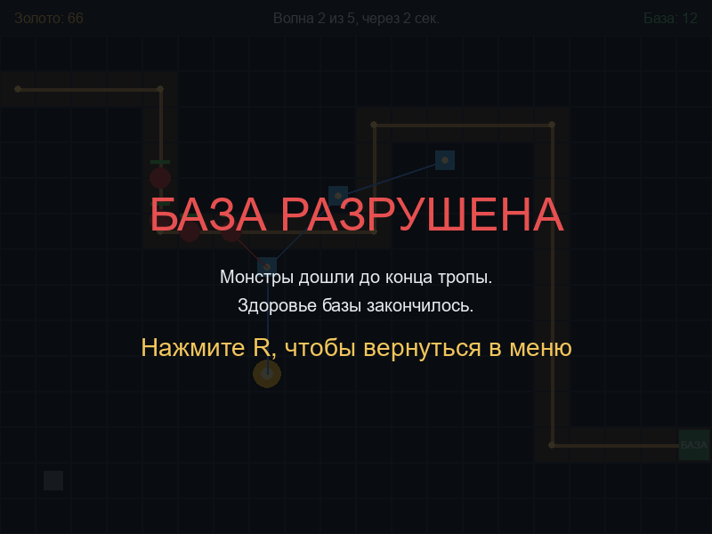

# Башни и энергия

Вариант 23, «Кооперативная оборона: Башни и Энергия». Tower defense на координатной сетке в окне Pygame. Монстры движутся по тропе к базе. Башня наносит урон ближайшему монстру в радиусе атаки только при наличии питания от генератора или от уже запитанной башни.

## Стек

- Python 3.12+
- Pygame 2.6.1

## Запуск

```bash
pip install -r requirements.txt
python main.py
```

На Windows можно запустить двойным щелчком по `ЗАПУСК.bat`.

## Управление

| Действие | Клавиша / кнопка |
| --- | --- |
| Ввести имя на стартовом экране | символы, Backspace стирает |
| Начать игру из меню | Enter |
| Построить башню | левая кнопка мыши по свободной клетке |
| Вернуться в меню после финала | R |
| Выход | закрыть окно |

Башня стоит 40 золота, на тропе и на генераторе строить нельзя.

## Механики

### Тропа и монстры

Тропа задаётся списком опорных точек `PATH_CORNERS` в `constants.py`. Модуль `level.py` переводит эти точки в пиксельные координаты и помечает клетки отрезков как непроходимые для постройки. Монстр в `enemy.py` смещается по прямой к текущей точке со скоростью волны. По достижении точки целью становится следующая. После последней точки монстр снимает 1 единицу `base_hp`.

### Башни

Постройка обрабатывается в `game.py`: клетка не должна входить в тропу, совпадать с генератором или быть занятой. Класс башни находится в `tower.py`. Каждый кадр башня выбирает живого монстра с минимальным расстоянием, не превышающим радиус атаки. Радиус задаётся константой `ATTACK_RADIUS` в `constants.py` и подменяется значением из внешнего конфига, если он загружен. Урон наносится не чаще одного раза в секунду.

### Энергосеть

Питание считается в `energy.py`. Генератор — источник. Башня запитана, если расстояние до генератора или до уже запитанной башни строго меньше `ENERGY_DISTANCE` из `constants.py`. Связность определяется поиском в ширину (BFS) от генератора по построенным башням. Расчёт выполняется заново каждый кадр в `game.py`, поэтому новая башня сразу получает или не получает право стрелять. Незапитанная башня цель не обрабатывает.

### Волны и золото

Параметры волн задаются списком `WAVES` в `constants.py`: число монстров, здоровье, скорость и награда. При успешной загрузке внешнего конфига вместо `WAVES` используется массив `monsters`. Перед первой волной выдерживается пауза. Монстры одной волны появляются с интервалом. Уничтоженный монстр увеличивает золото на величину `reward`. Золото списывается при установке башни.

### Победа и поражение

| Исход | Условие |
| --- | --- |
| Победа | все волны выпущены, монстров на поле нет, base_hp > 0 |
| Поражение | base_hp <= 0 |

Проверка выполняется в `game.py` после обновления монстров и башен.

## Структура проекта

```
grid_tower_defense/
├── main.py
├── constants.py
├── game.py
├── level.py
├── enemy.py
├── tower.py
├── energy.py
├── ui.py
├── requirements.txt
└── screenshots/
```

| Модуль | Назначение |
| --- | --- |
| `main.py` | Точка входа, вызов игрового цикла |
| `constants.py` | Размер окна, цвета, `PATH_CORNERS`, `ATTACK_RADIUS`, `ENERGY_DISTANCE`, `WAVES` |
| `game.py` | Цикл, ввод, спавн волн, итог партии |
| `level.py` | Сетка, тропа, генератор, база |
| `enemy.py` | Движение монстра по опорным точкам |
| `tower.py` | Выбор цели, кулдаун выстрела, отрисовка радиуса |
| `energy.py` | BFS питания башен от генератора |
| `ui.py` | Меню, панель состояния, экраны финала |

## Внешний конфиг

Файл `defense_balances.json` читается модулем `data_io.py` при создании партии.

```json
{
  "tower": {"cost": 40, "damage": 18, "radius": 120},
  "monsters": [
    {"count": 6, "hp": 36, "speed": 55, "reward": 8}
  ]
}
```

`tower.cost`, `tower.damage`, `tower.radius` заменяют цену, урон и `ATTACK_RADIUS`. Каждый элемент `monsters` заменяет соответствующую запись `WAVES`: `count`, `hp`, `speed`, `reward`.

Если файл отсутствует, JSON не разбирается или в объекте нет обязательных числовых полей, загрузчик перехватывает `FileNotFoundError`, `json.JSONDecodeError`, `KeyError`, `TypeError` и `ValueError`. В этом случае используются `TOWER_COST`, `TOWER_DAMAGE`, `ATTACK_RADIUS` и `WAVES` из `constants.py`. Текст ошибки выводится в стандартный поток вывода.

## Таблица результатов

При переходе в `STATE_VICTORY` или `STATE_DEFEAT` модуль `game.py` вызывает `save_score` из `data_io.py`. Функция дописывает строку в `scores.csv`. Если файла нет, он создаётся с заголовком `Имя,Волна,Статус,Время`.

`Имя` берётся из `self.player_name`. Пустое имя записывается как `Игрок`. `Волна` — номер волны, на которой партия закончилась. `Статус` — `Победа` или `Поражение`. `Время` — момент записи в формате `HH:MM:SS`.

Файл открывается через `csv.writer` с `encoding="utf-8"` и `newline=""`. Запись в `log_defense.txt` при поражении выполняется отдельно и не изменяется.

## Скриншоты

### Меню



Стартовый экран: правила, легенда и поле имени.

### Игра



Волна на тропе, запитанные башни и башня вне радиуса `ENERGY_DISTANCE`.

### Победа



Все волны пройдены, `base_hp` больше нуля.

### Поражение



`base_hp` опустилось до нуля.

## Зависимости

- Python 3.12+
- Pygame 2.6.1

```bash
python -c "import pygame; print(pygame.__version__)"
```
